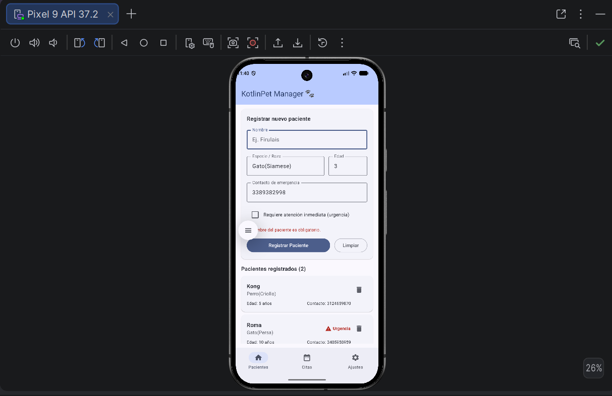

# 🐾 KotlinPet Manager

**Estudiante:** Jose Miguel Zambrano Carmona
**Código:** 1031805520
**Asignatura:** Desarrollo de Aplicativos Móviles (EE053)

App Android con Jetpack Compose y MVVM para registrar y visualizar pacientes de una clínica veterinaria. Permite ingresar nombre, especie/raza, edad y contacto de emergencia, marcar urgencias y ver la lista de pacientes en tiempo real.

## Captura de pantalla

